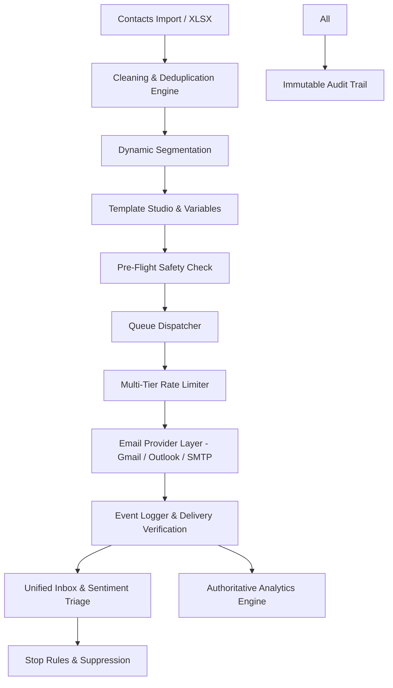

# HENU MAIL — SYSTEM ARCHITECTURE

**HENU OS PRIVATE LIMITED**

---

## 1. High-Level Flow Diagram

---

## 2. Core Architectural Subsystems

### 2.1 Ingestion & Cleaning Engine
* Stream-based parsing for `.xlsx` and `.csv` files using `xlsx` and `papaparse`.
* Heuristic column recognition matching over 15 standard name and contact variations.
* In-memory duplicate indexing and regex RFC syntax verification.

### 2.2 Template Studio
* Dual-mode editor: Visual draggable blocks and raw HTML editor.
* Interpolation engine supporting contextual defaults: `{{first_name | default: "there"}}`.
* Spam pattern analyzer rating subject and body copy with deliverability recommendations.

### 2.3 Provider Abstraction Layer
* `EmailProvider` interface decoupling transport logic from campaigns.
* `GmailProvider` implementing OAuth 2.0 authorization code exchange, token refresh, and RFC 2822 MIME compilation.
* Pluggable provider factory supporting Outlook (MS Graph) and generic SMTP.

### 2.4 Sending & Rate Limiting Engine
* 5-Tier hierarchical throttle: Provider Daily, Workspace Daily, Account Daily/Hourly, Campaign Pacing, Safety Burst.
* Controlled exponential backoff with jitter on transient failures.
* Emergency Killswitch: Instant global circuit breaker halting all worker dispatches.

### 2.5 Follow-Up Sequence & Abort Guardrails
* Multi-step scheduling with wait intervals.
* Stop triggers: Inbound reply, unsubscribe, hard bounce, manual suppression.

---

© 2026 **HENU OS Private Limited**. All rights reserved.
