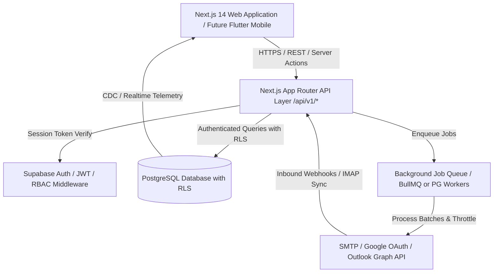

# Technical Architecture Document

## Project: HENU MAIL
**Architect:** HENU OS Private Limited Systems Engineering  
**Version:** 1.0.0  

---

## 1. System Architecture Overview

---

## 2. Technology Stack Selection & Justification

| Component | Technology | Rationale |
| :--- | :--- | :--- |
| **Frontend Framework** | Next.js 14+ (App Router) | Server-side rendering, streaming UI, unified server actions, enterprise caching, optimal SEO. |
| **Language** | TypeScript (Strict Mode) | Complete type safety, zero `any` policy, unified interfaces between client, server, and future mobile schema generators. |
| **Styling & Design System** | Tailwind CSS + CSS Variables | High performance, zero runtime overhead, exact tokenized scientific telemetry palette. |
| **State & Data Fetching** | TanStack React Query v5 | Server state caching, optimistic updates, background refetching, query invalidation. |
| **Table Management** | TanStack React Table v8 | Virtualization ready, headless table architecture with sorting, filtering, row selection. |
| **Form & Validation** | React Hook Form + Zod | Schema-first client & server validation, minimal re-renders, typed error handling. |
| **Database & Auth** | PostgreSQL via Supabase | Built-in Row Level Security (RLS), ACID compliance, native JSONB, connection pooling (PgBouncer). |
| **Telemetry & Visuals** | Recharts + Lucide Icons | Responsive SVG charting, technical icons with precision stroke widths. |
| **Mobile Ready Layer** | RESTful `/api/v1/*` | Standard JSON contracts with bearer tokens, directly consumable by Flutter mobile clients. |

---

## 3. Database Schema Design (PostgreSQL / Supabase)

### 3.1 Core Entity Relationship Model

1. **`workspaces`**: Tenancy separation.
2. **`users_workspaces` (Memberships)**: Link users with granular roles (`owner`, `super_admin`, `admin`, `campaign_manager`, `outreach_manager`, `analyst`, `viewer`).
3. **`email_accounts`**: Connected sending accounts, provider configurations, warmup schedules, and health metrics.
4. **`contacts`**: Lead and contact records with custom attributes (JSONB), verification status, and engagement metrics.
5. **`segments`**: Dynamic rule sets and static list associations.
6. **`templates`**: Subject, HTML, text, and metadata definitions with variable placeholders.
7. **`campaigns`**: Master campaign records, schedules, sequence steps, split tests, and state machines (`draft`, `scheduled`, `running`, `paused`, `completed`, `aborted`).
8. **`campaign_leads`**: State tracking for each contact in a campaign (current step, status, timestamps, tracking IDs).
9. **`email_queue`**: Individual queued email dispatches with scheduled send times, retry counters, and payload snapshots.
10. **`email_logs`**: Immutable delivery logs (`queued`, `sent`, `delivered`, `opened`, `clicked`, `replied`, `bounced`, `failed`, `unsubscribed`).
11. **`suppression_list`**: Universal suppression repository (email, domain, reason, workspace scope or global).
12. **`inbox_threads` & `inbox_messages`**: Synchronized prospect replies and communication histories.
13. **`audit_logs`**: Immutable ledger of all administrative and mutation events.
14. **`system_settings`**: Global branding, legal information, and deliverability policies for HENU OS Private Limited.

---

## 4. API Specification & Standards

All API routes adhere to RESTful conventions under `/api/v1/`:
- `GET /api/v1/telemetry/overview` - Real-time metrics overview for dashboard
- `GET /api/v1/campaigns` & `POST /api/v1/campaigns`
- `GET /api/v1/campaigns/:id` & `PATCH /api/v1/campaigns/:id` & `DELETE /api/v1/campaigns/:id`
- `POST /api/v1/campaigns/:id/control` - Control actions (`pause`, `resume`, `abort`)
- `GET /api/v1/contacts` & `POST /api/v1/contacts`
- `POST /api/v1/contacts/bulk-import`
- `GET /api/v1/templates` & `POST /api/v1/templates`
- `GET /api/v1/email-accounts` & `POST /api/v1/email-accounts`
- `GET /api/v1/suppression` & `POST /api/v1/suppression`
- `GET /api/v1/audit-logs`
- `GET /api/v1/system/settings` & `PATCH /api/v1/system/settings`

---

## 5. Background Processing & Queue Architecture

To guarantee strict compliance with provider policies:
1. **Pacing Engine**: Messages are scheduled across distributed time slots with jitter to simulate natural human transmission.
2. **Warmup Scheduler**: Automatically increments daily dispatch volume according to a calibrated sigmoid curve.
3. **Pre-Flight Deliverability Filter**: Every queued item is screened against the `suppression_list` and SPF/DKIM verification status prior to dispatch.
4. **Idempotency**: Every dispatch has a deterministic UUID idempotency key to prevent double sends.

---

## 6. Mobile Application Integration (Flutter)

The REST API contracts are built with mobile-first stateless JWT authorization. Future Flutter applications can consume the exact same endpoints, data models, and business logic without any server modifications.
